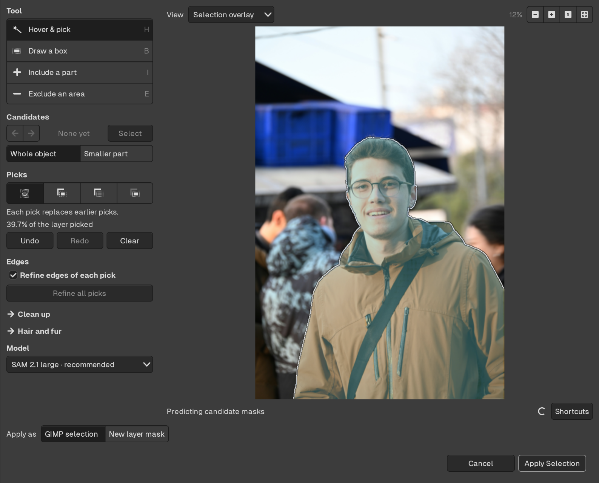

# Object Select for GIMP

A GIMP 3 plugin that selects objects in a layer when you hover and click, using SAM and BiRefNet locally.



<sub>Photo by [Halil Celik](https://unsplash.com/@halilcelikhic?utm_source=unsplash&utm_medium=referral&utm_content=creditCopyText) on [Unsplash](https://unsplash.com/photos/a-young-man-with-glasses-smiling-in-a-brown-jacket-kacgzKGzkZo?utm_source=unsplash&utm_medium=referral&utm_content=creditCopyText)</sub>

## Install

You need Linux or Windows, GIMP 3 (tested with the Linux Flatpak), Python 3.12 or 3.13, [uv](https://docs.astral.sh/uv/), and 16 GB of RAM. From the repository root, run:

```bash
uv sync
uv run python -m object_select.install
```

On Linux, add `--native` for a non-Flatpak GIMP. On Windows, start GIMP once before installing so it creates its settings folder. The installer looks for GIMP in `Program Files` and `%LOCALAPPDATA%\Programs`; if yours is elsewhere, add `--gimp-python "C:\path\to\GIMP 3\bin\python.exe"`. To choose the plug-ins directory yourself, add `--plugin-dir /path/to/plug-ins`. The installed plugin uses this repository's `.venv`, so keep the repository where it is.

Restart GIMP, then choose **Select > Object Select…**. The models download from Hugging Face on first use.

On Windows, if the model process stops, its log is at `%TEMP%\object-select-worker.log`.
